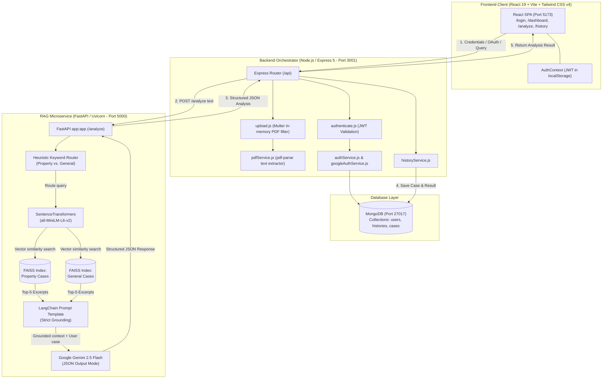

# ⚖️ Nyaay Sahayak (न्याय सहायक)

> **AI-Powered Legal Research & Precedent Intelligence Platform for Indian Jurisprudence**

[](https://nodejs.org/)
[](https://expressjs.com/)
[](https://react.dev/)
[](https://tailwindcss.com/)
[](https://www.python.org/)
[](https://fastapi.tiangolo.com/)
[](https://github.com/facebookresearch/faiss)
[](https://ai.google.dev/)
[](https://www.mongodb.com/)
[](https://opensource.org/licenses/ISC)

---

## 📑 Table of Contents

- [Overview](#-overview)
- [Key Features](#-key-features)
- [Screenshots & Demo](#-screenshots--demo)
- [Tech Stack](#-tech-stack)
- [System Architecture](#-system-architecture)
- [Project Structure](#-project-structure)
- [Prerequisites](#-prerequisites)
- [Installation & Setup](#-installation--setup)
- [Environment Variables](#-environment-variables)
- [Running the Application](#-running-the-application)
- [Usage Guide](#-usage-guide)
- [API Documentation](#-api-documentation)
- [Database Design](#-database-design)
- [Testing](#-testing)
- [Deployment](#-deployment)
- [Security Considerations](#-security-considerations)
- [Known Limitations](#-known-limitations)
- [Future Improvements](#-future-improvements)
- [Contributing](#-contributing)
- [License](#-license)

---

## 📖 Overview

### The Problem
Conducting legal research in the Indian justice system is notoriously laborious. With vast repositories of High Court and Supreme Court case laws, intricate statutory enactments (such as the Indian Penal Code, Bharatiya Nyaya Sanhita, Code of Criminal Procedure, Transfer of Property Act, and Protection of Women from Domestic Violence Act), finding relevant precedents and applicable sections manually can take advocates, legal scholars, and citizens hours or days of exhaustive searching.

### The Solution
**Nyaay Sahayak** (*"Justice Assistant"*) is a specialized full-stack legal intelligence platform. It bridges the gap between raw legal facts and actionable precedent research using a high-performance **Retrieval-Augmented Generation (RAG)** pipeline. Users can input factual narratives or upload complete PDF case briefs; the system automatically routes the query to domain-specific vector indices, retrieves the most factually and legally similar Indian court rulings via **FAISS** vector search, and leverages **Google Gemini 2.5 Flash** to synthesize:
1. An objective **Case Summary** of the presented facts.
2. Applicable **Legal Provisions** (specific Acts and statutory sections with contextual relevance).
3. Semantically ranked **Similar Case Precedents** from Indian High Courts (with citation metadata, match percentages, key parallels, and final rulings).
4. Explicit legal disclaimers to ensure ethical research usage.

### Target Users
- **Junior Advocates & Legal Researchers**: Rapid precedent discovery and case law comparison.
- **Law Students**: Interactive exploration of statutory applications against factual scenarios.
- **Citizens & Litigants**: Understanding legal dimensions and applicable rights prior to formal legal consultation.

---

## ✨ Key Features

- **Dual Input Processing**:
  - **Text Narratives**: Real-time validation requiring a minimum 50-character factual description with dynamic counter feedback.
  - **PDF Brief Ingestion**: Drag-and-drop or file selector support for court briefs up to 10MB. The Node.js layer extracts clean text in-memory via `pdf-parse` without saving unmanaged files to disk.
- **Domain-Specific Intent Routing**:
  - Automatically parses case facts against domain vocabulary (e.g., *encroachment*, *possession*, *tenant*, *rent*, *plot*, *boundary*) to dynamically direct queries to a dedicated **Property Law index** (163 curated High Court judgments) or a **General Appellate index** (171 curated judgments).
- **Dense Vector Search with Meta FAISS**:
  - Encodes case text into dense 384-dimensional normalized vector embeddings using HuggingFace's `all-MiniLM-L6-v2` Sentence Transformer.
  - Retrieves top-$K$ ($K=5$) nearest neighbors with cosine distance scoring using disk-persisted FAISS vector stores.
- **Grounded, Hallucination-Resistant LLM Synthesis**:
  - Uses `gemini-2.5-flash` with LangChain prompt templates enforcing strict factual grounding exclusively on retrieved judgment excerpts.
  - Generates strictly structured JSON outputs (`response_mime_type: "application/json"`) preventing unstructured model degradation.
- **End-to-End Authentication & Authorization**:
  - **Local Authentication**: Secure registration and login using `bcryptjs` salt hashing (10 rounds) and stateless `jsonwebtoken` (JWT) issuance.
  - **Google OAuth 2.0**: Single-Sign-On integration via Passport.js (`passport-google-oauth20`) with automatic account linking by email.
  - **Protected Routes**: Custom Express authentication middleware validating incoming `Bearer` tokens.
- **User History & Audit Trail**:
  - Automatically records every analysis session in MongoDB, preserving input excerpts, input method (`text` vs. `pdf`), and full AI output payloads.
  - Provides a dedicated history browser with real-time keyword filtering and instant deletion.
- **Executive Analytics Dashboard**:
  - Displays user profile summaries, dynamic case counter metrics (Total, Text, and PDF analyses), rotating quotes from Indian and international jurists, and quick-access cards to recent cases.
- **Modern Responsive Design System**:
  - Built with React 19 and Tailwind CSS v4.
  - Dark mode and light mode switching with automatic OS preference detection and `localStorage` persistence.
  - Expandable statutory provision cards, similarity percentage badges, and accessible loading state skeletons.

---
<!-- 
## 🖼️ Screenshots & Demo

> *Visual assets located in `client/src/assets/hero.png`.*

```
+------------------------------------------------------------------------------------+
|  ⚖️  Nyay-Sahayak        [Home]   [Analyze]   [History]            [☀️/🌙] [👤 User] |
+------------------------------------------------------------------------------------+
|                                                                                    |
|  [ New Case Analysis ]                                                             |
|  Submit case details or upload PDF briefs to consult our RAG precedents database.  |
|                                                                                    |
|  +--------------------------------+  +------------------------------------------+  |
|  | ⚖️ Case Description            |  | 📄 Case Summary                          |  |
|  | [ Textarea / 50 min chars    ] |  | Concisely synthesized summary of facts..  |  |
|  |                                |  +------------------------------------------+  |
|  | ----------- OR ------------    |  | ⚖️ Relevant Legal Provisions             |  |
|  | 📤 Drag & drop PDF brief (10MB)|  | 1. Section 147 IPC (Penal Code) [Expand]  |  |
|  |                                |  | 2. Section 97 IPC [Expand]               |  |
|  | [ Analyze Case File Button ]   |  +------------------------------------------+  |
|  +--------------------------------+  | 🏛️ Similar High Court Judgments (5)      |  |
|                                      | [Case Title] - 92% Match | Year: 1981    |  |
|                                      | Parallels: Dispute regarding possession..|  |
|                                      | Decision: Sentences set aside..          |  |
+--------------------------------------+------------------------------------------+--+
```

*(To capture screenshots for your public GitHub release, run the development environment, navigate through `/dashboard`, `/analyze`, and `/history`, and save screenshots in a `/docs/screenshots/` folder).* -->

---

## 💻 Tech Stack

### Frontend Client
- **Framework**: [React 19](https://react.dev/) (`v19.2.7`) with [Vite 8](https://vitejs.dev/) (`v8.1.0`)
- **Routing**: [React Router DOM](https://reactrouter.com/) (`v7.18.0`)
- **Styling**: [Tailwind CSS v4](https://tailwindcss.com/) with `@tailwindcss/vite` (`v4.3.1`)
- **HTTP Client**: [Axios](https://axios-http.com/) (`v1.18.1`)
- **Linter**: [Oxlint](https://oxc.rs/) (`v1.69.0`)

### Backend API Gateway
- **Runtime**: [Node.js](https://nodejs.org/) (v18+ or v20+ LTS)
- **Framework**: [Express 5](https://expressjs.com/) (`v5.2.1`)
- **Database ODM**: [Mongoose 9](https://mongoosejs.com/) (`v9.6.3`)
- **Authentication**:
  - [JSON Web Token (JWT)](https://jwt.io/) (`jsonwebtoken v9.0.3`)
  - [Bcrypt.js](https://github.com/dcodeIO/bcrypt.js) (`bcryptjs v3.0.3`)
  - [Passport.js](https://www.passportjs.org/) (`passport v0.7.0` & `passport-google-oauth20 v2.0.0`)
- **File Ingestion**: [Multer](https://github.com/expressjs/multer) (`v2.1.1`) & [PDF-Parse](https://gitlab.com/nisaacson/pdf-parse) (`v2.4.5`)
- **Utilities**: `dotenv`, `cors`, `nodemon`

### RAG Microservice (Python)
- **Framework**: [FastAPI](https://fastapi.tiangolo.com/) with [Uvicorn](https://www.uvicorn.org/)
- **Vector Search Engine**: [Meta FAISS (CPU)](https://github.com/facebookresearch/faiss) (`faiss-cpu`)
- **Embeddings**: [HuggingFace Sentence Transformers](https://sbert.net/) (`sentence-transformers`) using `all-MiniLM-L6-v2` (384-dimensional dense vectors)
- **LLM Orchestration**: [LangChain](https://www.langchain.com/) (`langchain`, `langchain-community`, `langchain-core`, `langchain-text-splitters`)
- **Generative Model**: [Google Gemini 2.5 Flash](https://ai.google.dev/) (`google-generativeai`)
- **Data Validation**: [Pydantic](https://docs.pydantic.dev/)

### Database & Precedent Corpus
- **Primary Database**: [MongoDB](https://www.mongodb.com/) (Collections: `users`, `histories`, and prepared schema for `cases`)
- **Case Datasets**: 334+ curated Indian legal judgments structured in JSON:
  - `propertyCases.json`: 163 specialized land, property, tenancy, and possession cases.
  - `importedCases.json`: 171 high court appellate cases covering criminal, domestic, and civil disputes.

---

## 🏛️ System Architecture

Nyaay Sahayak is architected as an asynchronous microservices system separating user-facing interaction, business orchestration/authentication, and heavy vector machine learning workloads:



---

## 📂 Project Structure

```
nyaay-sahayak/
├── client/                          # Frontend React SPA
│   ├── public/                      # Static assets, SVG icons, and favicon
│   ├── src/
│   │   ├── api/                     # Axios API service clients
│   │   │   ├── authApi.js           # Signup, login, and current user fetch
│   │   │   ├── config.js            # Central API base URL configuration
│   │   │   └── historyApi.js        # History retrieval and deletion
│   │   ├── assets/                  # Local graphics and hero banner
│   │   ├── components/              # Modular UI components
│   │   │   ├── AnalyzingLoader.jsx  # Animated pulse loader during RAG execution
│   │   │   ├── AuthPanel.jsx        # Login & Signup toggle form
│   │   │   ├── CaseSummary.jsx      # Rendered case summary section
│   │   │   ├── HistoryPanel.jsx     # History overview panel
│   │   │   ├── InputPanel.jsx       # Case textarea and PDF drag-and-drop selector
│   │   │   ├── Layout.jsx           # Global responsive layout wrapper
│   │   │   ├── LegalProvisions.jsx  # Interactive, expandable statutory sections
│   │   │   ├── Navbar.jsx           # Responsive navigation with dark mode switch
│   │   │   ├── ResultPanel.jsx      # Top-level container for all analysis results
│   │   │   └── SimilarCases.jsx     # Ranked precedents with match score badges
│   │   ├── context/
│   │   │   └── AuthContext.jsx      # User session state and token management
│   │   ├── pages/                   # Application route views
│   │   │   ├── Analyze.jsx          # Primary case submission and analysis view
│   │   │   ├── Dashboard.jsx        # User metrics, jurist quotes, and quick links
│   │   │   ├── History.jsx          # Searchable, filterable case history table
│   │   │   ├── Home.jsx             # Public landing page and workflow guide
│   │   │   └── Login.jsx            # Authentication view
│   │   ├── App.jsx                  # Main router and theme initialization
│   │   ├── index.css                # Tailwind CSS v4 design tokens and theme rules
│   │   └── main.jsx                 # React root mount point
│   ├── index.html                   # HTML entry point
│   ├── package.json                 # Client dependencies and Vite scripts
│   └── vite.config.js               # Vite bundler configuration
│
├── server/                          # Node.js / Express API Gateway
│   ├── config.js                    # Environment configuration loader with fallbacks
│   ├── index.js                     # Express entry point, middleware, and HTTP server
│   ├── data/                        # Curated Indian precedent corpora
│   │   ├── importedCases.json       # 171 General & Appellate court judgments
│   │   ├── propertyCases.json       # 163 Property and land dispute judgments
│   │   ├── history.json             # Static fallback data store
│   │   └── users.json               # Static fallback data store
│   ├── middleware/
│   │   ├── authenticate.js          # JWT Bearer token authentication guard
│   │   ├── errorHandler.js          # Global centralized error handler
│   │   └── upload.js                # Multer in-memory PDF validation (Max 10MB)
│   ├── models/                      # Mongoose Schema Definitions
│   │   ├── Case.js                  # Prepared schema with text normalization hooks
│   │   ├── History.js               # History schema indexed on { userId, createdAt }
│   │   └── User.js                  # User schema with local/Google auth support
│   ├── passport/
│   │   └── googleStrategy.js        # Google OAuth 2.0 Passport configuration
│   ├── routes/
│   │   ├── analyzeRoute.js          # POST /api/analyze (PDF/Text RAG dispatcher)
│   │   ├── authRoute.js             # Authentication routes (login, signup, /me, google)
│   │   ├── historyRoute.js          # Case history retrieval and deletion routes
│   │   └── uploadRoute.js           # Generic upload router
│   ├── services/
│   │   ├── authService.js           # Bcrypt hashing, token issuance, and validation
│   │   ├── googleAuthService.js     # Google profile upsert and account linking
│   │   ├── historyService.js        # MongoDB CRUD operations for analysis records
│   │   ├── mongoService.js          # Mongoose database connection manager
│   │   └── pdfService.js            # In-memory text extraction from PDF buffers
│   └── package.json                 # Node.js backend dependencies and scripts
│
└── rag_services/                    # Python FastAPI RAG Microservice
    ├── app.py                       # FastAPI application exposing POST /analyze
    ├── config/
    │   └── settings.py              # Configuration constants, paths, and model names
    ├── loaders/
    │   └── case_loader.py           # JSON dataset loader for legal cases
    ├── prompts/
    │   └── legal_prompt.py          # Grounded prompt template mandating JSON format
    ├── services/
    │   ├── chunking_service.py      # RecursiveCharacterTextSplitter (700 char chunks)
    │   ├── document_service.py      # LangChain Document construction with metadata
    │   ├── embedding_service.py     # SentenceTransformerEmbeddings (all-MiniLM-L6-v2)
    │   ├── faiss_service.py         # FAISS vector store save, load, and cache logic
    │   ├── gemini_service.py        # Gemini 2.5 Flash API connector and JSON decoder
    │   └── rag_service.py           # Auto-detection heuristic and RAG execution pipeline
    ├── ingest.py                    # Script to build and persist FAISS vector indices
    ├── test_auto_detect.py          # Verification script for query intent routing
    ├── test_retrieval.py            # Verification script for vector similarity search
    └── requirements.txt             # Python dependency manifest
```

---

## ⚙️ Prerequisites

Ensure the following runtimes and databases are installed on your host machine:

| Component | Minimum Version | Recommended Version | Purpose |
| :--- | :--- | :--- | :--- |
| **Node.js** | `v18.0.0` | `v20.x LTS` | Runs Express server and Vite development bundler |
| **npm** | `v9.0.0` | `v10.x` | Node package manager |
| **Python** | `3.10.x` | `3.11.x` | Runs FastAPI, PyTorch, SentenceTransformers, and FAISS |
| **MongoDB** | `v6.0.0` | `v7.0+` | Local MongoDB daemon or MongoDB Atlas cloud cluster |
| **Google Gemini Key** | N/A | Active Key | Access to `gemini-2.5-flash` model via Google AI Studio |

---

## 🚀 Installation & Setup

Follow these sequential steps to clone and initialize all three tiers of the project.

### 1. Clone the Repository
```bash
git clone https://github.com/NyaySahayakTech/nyaay-sahayak.git
cd nyaay-sahayak
```

---

### 2. Configure the Python RAG Microservice
The RAG service requires a Python virtual environment and pre-computed FAISS vector indices.

```bash
# Navigate to the RAG services directory
cd rag_services

# Create a virtual environment
python3 -m venv venv

# Activate the virtual environment
# On macOS / Linux:
source venv/bin/activate
# On Windows (cmd):
# venv\Scripts\activate.bat
# On Windows (PowerShell):
# venv\Scripts\Activate.ps1

# Upgrade pip and install dependencies
pip install --upgrade pip
pip install -r requirements.txt

# Create the environment configuration file
cat <<EOF > .env
GEMINI_API_KEY=your_google_gemini_api_key_here
EOF

# Build the FAISS vector indices (processes 334+ cases into property and general indices)
python ingest.py

# Return to the project root
cd ..
```

---

### 3. Configure the Node.js Express API Server
The backend requires connection strings for MongoDB and secrets for JWT tokens.

```bash
# Navigate to the server directory
cd server

# Install dependencies
npm install

# Create the server environment file
cat <<EOF > .env
PORT=3001
MONGODB_URI=mongodb://127.0.0.1:27017
MONGODB_DB_NAME=nyayasahayak
JWT_SECRET=your_super_secret_jwt_signing_key_min_32_chars
JWT_EXPIRES_IN=7d
GOOGLE_CLIENT_ID=your_google_oauth_client_id_optional
GOOGLE_CLIENT_SECRET=your_google_oauth_client_secret_optional
EOF

# Return to the project root
cd ..
```

---

### 4. Configure the React Frontend Client
The client connects to the Node.js API server over HTTP.

```bash
# Navigate to the client directory
cd client

# Install dependencies
npm install

# Optionally configure custom API base URL (defaults to http://localhost:3001)
cat <<EOF > .env
VITE_API_BASE=http://localhost:3001
EOF

# Return to the project root
cd ..
```

---

## 🔐 Environment Variables

### 1. Backend Server (`server/.env`)
| Variable | Required | Default Value | Description |
| :--- | :---: | :--- | :--- |
| `PORT` | No | `3001` | Port number Express listens on |
| `MONGODB_URI` | **Yes** | `mongodb://127.0.0.1:27017` | MongoDB connection URI (local or Atlas) |
| `MONGODB_DB_NAME` | No | `nyayasahayak` | Target MongoDB database name |
| `JWT_SECRET` | **Yes** | `development-secret` | Secret key used to sign and verify JWT authentication tokens |
| `JWT_EXPIRES_IN` | No | `7d` | Token expiration duration (e.g., `1d`, `7d`) |
| `GOOGLE_CLIENT_ID` | Conditional | `placeholder-client-id` | Google Cloud Console OAuth 2.0 Client ID (required for Google Login) |
| `GOOGLE_CLIENT_SECRET`| Conditional | `placeholder-client-secret` | Google Cloud Console OAuth 2.0 Client Secret (required for Google Login) |

### 2. RAG Microservice (`rag_services/.env`)
| Variable | Required | Default Value | Description |
| :--- | :---: | :--- | :--- |
| `GEMINI_API_KEY` | **Yes** | *None* | Google AI Studio API key used to generate grounded legal completions |

### 3. Frontend Client (`client/.env`)
| Variable | Required | Default Value | Description |
| :--- | :---: | :--- | :--- |
| `VITE_API_BASE` | No | `http://localhost:3001` | Base URL of the Node.js Express API server |

> [!CAUTION]
> Never commit actual `.env` files or API secrets to version control. The repository `.gitignore` is already pre-configured to ignore all `.env` files and the generated `faiss_index/` directory.

---

## 🏃 Running the Application

To run the complete system, start the three services in separate terminal windows:

### Terminal 1: Python RAG Microservice (Port 5000)
```bash
cd rag_services
source venv/bin/activate
uvicorn app:app --host 127.0.0.1 --port 5000 --reload
```
*Verification: Verify `http://127.0.0.1:5000/health` returns `{"status":"ok","message":"RAG API is running"}`.*

### Terminal 2: Node.js Express API Server (Port 3001)
```bash
cd server
npm run dev
```
*Verification: Console logs `MongoDB connected successfully` and `Server running on http://localhost:3001`.*

### Terminal 3: React Frontend Client (Port 5173)
```bash
cd client
npm run dev
```
*Access the user interface at `http://localhost:5173`.*

---

## 🧭 Usage Guide

### 1. User Registration & Onboarding
- Navigate to `http://localhost:5173/login`.
- Click **"Register"** to create a new local account with Name, Email, and Password (minimum 6 characters), or sign in with an existing account.
- Upon successful authentication, a JWT is securely stored in `localStorage` and the user is redirected to the `/dashboard`.

### 2. Consulting the Analytics Dashboard
- View personalized metrics including total analyses conducted, text breakdown, and PDF breakdown.
- Read daily rotating judicial quotes from prominent jurists.
- Click on any recent case card to instantly reopen past findings.

### 3. Running a Case Analysis (`/analyze`)
1. **Choose an Input Modality**:
   - **Text Option**: Enter detailed case facts into the description area (parties involved, sequence of events, nature of dispute, police action, etc.). The dynamic counter requires at least 50 characters to enable submission.
   - **PDF Option**: Drag and drop a legal petition, FIR copy, or court brief (PDF format, up to 10MB).
2. **Execute Analysis**:
   - Click **"Analyze Case File"**. The UI activates an animated legal reasoning spinner.
3. **Inspect Structured Findings**:
   - **Case Summary**: A high-level synthesis of the dispute.
   - **Relevant Legal Provisions**: Click on statutory cards to expand or collapse legal explanations detailing why sections of the Penal Code, Civil Code, or Special Acts apply.
   - **Similar High Court Judgments**: Inspect side-by-side precedent cards showing case citations, judgment year, calculated similarity score percentage, key factual parallels, and final judicial orders.
   - **Legal Disclaimer**: Reviews the AI research advisory notice.

### 4. Managing Case History (`/history`)
- Access a chronological registry of all past analyses.
- Use the live search bar to query past briefs by factual keyword, legal section, or input type.
- Click **"Open result"** to load the complete historical analysis into the results viewer.
- Click **"Delete"** to permanently remove an entry from MongoDB.

---

## 📡 API Documentation

### Express Backend API Gateway (`http://localhost:3001`)

#### 1. Authentication Endpoints

##### `POST /api/signup`
Creates a new local user account.
- **Headers**: `Content-Type: application/json`
- **Request Body**:
  ```json
  {
    "name": "Adhiraj Sharma",
    "email": "adhiraj@example.com",
    "password": "SecurePassword123"
  }
  ```
- **Response** (`201 Created`):
  ```json
  {
    "success": true,
    "token": "eyJhbGciOiJIUzI1NiIsInR5cCI6IkpXVCJ9...",
    "user": {
      "id": "670f5e128...",
      "name": "Adhiraj Sharma",
      "email": "adhiraj@example.com",
      "avatarUrl": "",
      "authProvider": "local",
      "createdAt": "2026-10-15T16:30:00.000Z"
    }
  }
  ```

##### `POST /api/login`
Authenticates user credentials and returns a JWT.
- **Headers**: `Content-Type: application/json`
- **Request Body**:
  ```json
  {
    "email": "adhiraj@example.com",
    "password": "SecurePassword123"
  }
  ```
- **Response** (`200 OK`):
  ```json
  {
    "success": true,
    "token": "eyJhbGciOiJIUzI1NiIsInR5cCI6IkpXVCJ9...",
    "user": { ... }
  }
  ```

##### `GET /api/me`
Fetches the profile of the currently authenticated user.
- **Headers**: `Authorization: Bearer <token>`
- **Response** (`200 OK`):
  ```json
  {
    "success": true,
    "user": {
      "id": "670f5e128...",
      "name": "Adhiraj Sharma",
      "email": "adhiraj@example.com"
    }
  }
  ```

---

#### 2. Analysis & RAG Endpoints

##### `POST /api/analyze`
Submits a case narrative or PDF file for automated precedent retrieval and AI analysis.
- **Headers**: `Authorization: Bearer <token>`, `Content-Type: multipart/form-data` or `application/json`
- **Request Parameters**:
  - `file` (Multipart file, optional): PDF document (max 10MB).
  - `text` (JSON string, optional): Plaintext case facts (minimum 50 characters).
- **Response** (`200 OK`):
  ```json
  {
    "case_type": "property",
    "answer": {
      "analysis": "The dispute centers on unlawful encroachment and possession of agricultural land...",
      "summary": "The applicant alleges that adjacent occupants unlawfully seized boundary land...",
      "legalProvisions": [
        {
          "section": "Section 147",
          "act": "Indian Penal Code",
          "relevance": "Pertains to punishment for rioting during unlawful assembly over property boundaries."
        },
        {
          "section": "Section 97",
          "act": "Indian Penal Code",
          "relevance": "Covers right of private defense of property against criminal trespass."
        }
      ],
      "similarCases": [
        {
          "caseTitle": "Abdul_Sattar_vs_Board_Of_Revenue",
          "year": "1981",
          "caseNumber": "Civil Appeal 412/1981",
          "caseId": null,
          "pdfUrl": null,
          "similarityScore": 88,
          "keyParallels": "Involves dispute over demarcation and possession under revenue code.",
          "decision": "Order of the revenue authority was quashed and remanded for physical verification."
        }
      ],
      "disclaimer": "This response is AI-generated legal research and informational assistance only. It is not legal advice..."
    }
  }
  ```

---

#### 3. History Endpoints

##### `GET /api/history`
Retrieves all historical case analyses for the authenticated user, sorted in descending chronological order.
- **Headers**: `Authorization: Bearer <token>`
- **Response** (`200 OK`):
  ```json
  {
    "success": true,
    "history": [
      {
        "id": "670f6120...",
        "userId": "670f5e128...",
        "createdAt": "2026-10-15T16:45:00.000Z",
        "inputType": "pdf",
        "inputPreview": "IN THE HIGH COURT OF JUDICATURE AT ALLAHABAD... Dispute concerning boundary...",
        "analysis": { ... }
      }
    ]
  }
  ```

##### `DELETE /api/history/:id`
Deletes a specific history record by ID.
- **Headers**: `Authorization: Bearer <token>`
- **Response** (`200 OK`):
  ```json
  {
    "success": true,
    "message": "History deleted successfully"
  }
  ```

---

### Python RAG Microservice API (`http://localhost:5000`)

##### `GET /health`
Returns microservice operational status.
- **Response** (`200 OK`): `{"status": "ok", "message": "RAG API is running"}`

##### `POST /analyze`
Internal endpoint invoked by the Express gateway.
- **Request Body**: `{"text": "Case factual narrative..."}`
- **Response** (`200 OK`): Returns JSON containing detected `case_type` and LLM synthesis `answer`.

---

## 🗄️ Database Design

Nyaay Sahayak utilizes MongoDB managed through Mongoose models:

### 1. `User` Schema (`server/models/User.js`)
Stores authentication credentials, provider identities, and profile details.
```javascript
{
  name: { type: String, required: true, trim: true, minlength: 2 },
  email: { type: String, required: true, unique: true, lowercase: true, trim: true },
  passwordHash: { type: String, default: null }, // Nullable for OAuth accounts
  authProvider: { type: String, enum: ["local", "google"], default: "local" },
  googleId: { type: String, unique: true, sparse: true },
  avatarUrl: { type: String, default: "" },
  sex: { type: String, enum: ["", "male", "female", "other", "prefer_not_to_say"], default: "" },
  passwordResetTokenHash: { type: String, default: null, index: true },
  passwordResetExpiresAt: { type: Date, default: null },
  timestamps: true // createdAt, updatedAt
}
```

### 2. `History` Schema (`server/models/History.js`)
Stores historical analyses linked to the user account.
```javascript
{
  userId: { type: mongoose.Schema.Types.ObjectId, ref: "User", required: true, index: true },
  inputType: { type: String, enum: ["text", "pdf"], default: "text" },
  inputPreview: { type: String, required: true, trim: true }, // Max 220 characters
  analysis: { type: Object, required: true }, // Full JSON analysis output from Gemini
  timestamps: true
}
// Compound Index: { userId: 1, createdAt: -1 }
```

### 3. `Case` Schema (`server/models/Case.js`)
A prepared enterprise collection schema designed for storing pre-indexed case laws directly in MongoDB, complete with pre-validation hooks for text normalization:
```javascript
{
  caseTitle: { type: String, required: true, trim: true },
  caseNumber: { type: String, default: "", trim: true },
  year: { type: Number, default: null },
  facts: { type: String, default: "" },
  legalReasoning: { type: String, default: "" },
  decision: { type: String, default: "" },
  relevantSections: { type: [String], default: [] },
  sourceFile: { type: String, required: true, unique: true },
  pdfUrl: { type: String, required: true },
  embedding: { type: [Number], default: undefined },
  normalizedTitle: { type: String, index: true },
  caseNumberNormalized: { type: String, index: true },
  sourceFileNormalized: { type: String, index: true },
  timestamps: true
}
```

---

## 🧪 Testing

The repository contains automated scripts to test vector retrieval and intent routing in the Python RAG subsystem:

### 1. Vector Similarity Retrieval Test
Verifies that the `property` FAISS vector index correctly loads embeddings and returns top matching precedents with cosine similarity scores.
```bash
cd rag_services
source venv/bin/activate
python test_retrieval.py
```
*Expected Output: Prints 5 ranked precedent chunks with similarity scores for the sample query `"My neighbour occupied my land"`.*

### 2. Heuristic Intent & Auto-Detection Test
Verifies keyword parsing and dynamic routing between `property` and `general` FAISS indices.
```bash
cd rag_services
source venv/bin/activate
python test_auto_detect.py
```
*Expected Output: Confirms `Selected Index: property` for the sample tenancy deposit dispute query.*

### 3. Frontend Code Quality & Static Analysis
To check frontend code for syntax and style compliance:
```bash
cd client
npm run lint
```

---

## 🚢 Deployment

### Recommended Multi-Service Architecture

```
                      +-----------------------------+
                      |   Cloudflare / DNS & CDN    |
                      +--------------+--------------+
                                     |
               +---------------------+---------------------+
               |                                           |
      (HTTPS Traffic)                             (API Calls /api/*)
               v                                           v
+-------------------------------+             +---------------------------+
| Vercel / Netlify              |             | Render / Railway / ECS    |
| (React 19 Frontend SPA)       |             | (Node.js Express Server)  |
+-------------------------------+             +-------------+-------------+
                                                            |
                                                   (Internal Private VPC)
                                                            v
+-------------------------------+             +---------------------------+
| MongoDB Atlas                 |<------------+ Render / Cloud Run / EC2  |
| (Managed Database Cluster)    |             | (Python FastAPI + FAISS)  |
+-------------------------------+             +---------------------------+
```

1. **Frontend (Vercel / Netlify)**:
   - Build Command: `npm run build`
   - Output Directory: `dist`
   - Set environment variable `VITE_API_BASE` pointing to your deployed Express API domain.
2. **Backend API Gateway (Render / Railway / DigitalOcean)**:
   - Start Command: `npm start`
   - Expose HTTP port and configure environment variables (`MONGODB_URI`, `JWT_SECRET`, etc.).
   - Configure proxy to internal FastAPI service URL.
3. **Python RAG Microservice (Docker / AWS EC2 / GCP Cloud Run)**:
   - Deploy as a Docker container with pre-built FAISS indices (`python ingest.py` executed during image build).
   - Start Command: `uvicorn app:app --host 0.0.0.0 --port 5000`
   - Supply `GEMINI_API_KEY` via environment secrets.

---

## 🛡️ Security Considerations

- **Password Hashing**: User passwords are never saved in plaintext; `bcryptjs` is applied with a work factor of 10 rounds prior to database insertion.
- **Authentication & Stateless Tokens**: APIs are protected using JSON Web Tokens (JWT) signed with a server secret. Protected endpoints reject requests lacking a valid `Bearer <token>` header with HTTP 401 Unauthorized.
- **Safe Memory-Buffered File Handling**: Uploaded PDF files are buffered strictly in RAM using `multer.memoryStorage()`, verified for `application/pdf` MIME headers and `.pdf` extensions, capped at 10MB, and never written to unmanaged disk directories.
- **Prompt Injection & Hallucination Mitigation**: The RAG prompt template strictly forbids the LLM from hallucinating legal statutes or drawing from outside assumptions. By setting `response_mime_type: "application/json"`, the model is constrained against emitting rogue instructions.
- **Mandatory Ethical AI Disclaimers**: Every output generated by the RAG service automatically appends a formal legal disclaimer reminding users that the system provides informational research assistance and does not constitute a formal attorney-client relationship.

---

## ⚠️ Known Limitations

- **Text-Only PDF Parsing**: The current `pdf-parse` integration extracts digital text layers. Scanned image-based PDFs without OCR cannot be read and return an explicit error requesting a text-based document.
- **Heuristic Query Routing**: The classification between the `property` index and `general` index relies on keyword matching (`PROPERTY_KEYWORDS`). Complex ambiguous queries containing overlapping context may default to the general index.
- **Static Dataset Ingestion**: The FAISS indices are generated from static files (`server/data/propertyCases.json` and `importedCases.json`). Dynamic indexing from newly inserted MongoDB cases requires triggering `ingest.py`.
- **Single-Node Vector Cache**: FAISS indices are cached in memory per process; scaling across multiple replicas requires shared distributed vector indexing or external vector database solutions.

---

## 🔮 Future Improvements

- [ ] **OCR Preprocessing Pipeline**: Integrate Tesseract OCR or Google Cloud Vision to process scanned PDF petitions and handwritten court orders.
- [ ] **Hybrid Search with BM25**: Combine FAISS dense semantic embeddings with sparse keyword search (BM25) using LangChain's `EnsembleRetriever` for enhanced legal citation accuracy.
- [ ] **Conversational Multi-Turn Consultation**: Enable follow-up queries and conversational memory so lawyers can interrogate specific aspects of retrieved judgments.
- [ ] **Bilingual & Vernacular Support**: Expand queries and synthesis to Hindi and regional Indian languages to democratize legal aid across all Indian states.
- [ ] **Live MongoDB Vector Sync**: Stream changes from the MongoDB `cases` collection directly into vector stores using change streams.

---

## 🤝 Contributing

Contributions are welcome! Please follow these steps:

1. **Fork the Repository** on GitHub.
2. **Create a Feature Branch**:
   ```bash
   git checkout -b feature/your-feature-name
   ```
3. **Commit Your Changes**:
   ```bash
   git commit -m "feat: describe the new capability"
   ```
4. **Push to Your Branch**:
   ```bash
   git push origin feature/your-feature-name
   ```
5. **Open a Pull Request** explaining your modifications and testing steps.

---

## 📄 License

This project is licensed under the [ISC License](https://opensource.org/licenses/ISC) as specified in `server/package.json`.

---

<div align="center">
  <sub>Built with ❤️ for accessible, transparent, and intelligent legal research in India.</sub>
</div>